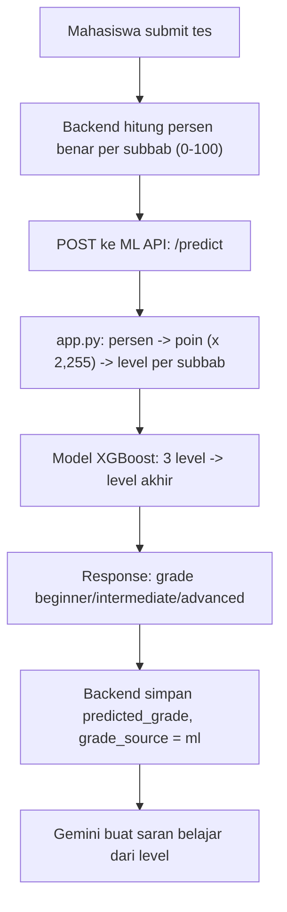

# ML Deploy Plan — Klasifikasi Level IAET (`test-capstone.ipynb`)

Tujuan: mahasiswa submit pretest/real test, backend memanggil API ML, level akhir tersimpan dengan `grade_source = 'ml'`.

---

## 1. Aturan Final & Pembagian Soal (Format Tim IAET: Rata 50 Soal / Total 150 Soal)

Format resmi tes IAET-SIM:

1. **Listening Comprehension**: **50 Soal**
2. **Structure & Written Expression (SWE)**: **50 Soal**
3. **Reading Comprehension**: **50 Soal**
   **Total: 150 Soal** (Rata 50 soal per subbab, 4,51 poin per soal benar)

- Skor maksimal per subbab: 50 × 4,51 = **225,50 poin**.
- Skor maksimal total (`overall_score`): 3 × 225,50 = **676,50 poin**.

### Threshold Level per Subbab (Sama Persis untuk Listening, Structure, & Reading)

Backend menghitung nilai dalam **persentase (0–100%)** via rumus: `(jumlah_benar / total_soal) * 100`.
Karena semua subbab rata 50 butir soal, pembagiannya seragam:

| Subbab              | Total Soal | 🥉 Beginner (≤ 30%)                    | 🥈 Intermediate (32%–80%)                    | 🥇 Advanced (≥ 82%)                           |
| ------------------- | ---------- | -------------------------------------- | -------------------------------------------- | --------------------------------------------- |
| **Listening**       | 50 soal    | **0 – 15 soal** benar (skor 0 – 67,65) | **16 – 40 soal** benar (skor 72,16 – 180,40) | **41 – 50 soal** benar (skor 184,91 – 225,50) |
| **Structure (SWE)** | 50 soal    | **0 – 15 soal** benar (skor 0 – 67,65) | **16 – 40 soal** benar (skor 72,16 – 180,40) | **41 – 50 soal** benar (skor 184,91 – 225,50) |
| **Reading**         | 50 soal    | **0 – 15 soal** benar (skor 0 – 67,65) | **16 – 40 soal** benar (skor 72,16 – 180,40) | **41 – 50 soal** benar (skor 184,91 – 225,50) |

> **Ambang Batas Pemisah (Titik Tengah) di API ML (`app.py`):**
>
> - Batas $B_1$ (Beginner ↔ Intermediate): **69,905 poin** (setara **31,0%**)
> - Batas $B_2$ (Intermediate ↔ Advanced): **182,655 poin** (setara **81,0%**)
>
> _Catatan:_ Karena backend mengirimkan nilai dalam bentuk persentase (0–100), rumus konversi di `app.py`: `poin = (persen / 100) * 225.5` langsung memetakan nilai mahasiswa ke batas $B_1$ dan $B_2$ di atas secara 100% presisi.

### Level akhir (`overall_level`) dari kombinasi 3 subbab, urutan tidak berpengaruh

| Kombinasi | Level akhir  |
| --------- | ------------ |
| B, B, B   | Beginner     |
| B, B, I   | Beginner     |
| B, B, A   | Intermediate |
| B, I, I   | Intermediate |
| B, I, A   | Intermediate |
| B, A, A   | Intermediate |
| I, I, I   | Intermediate |
| I, I, A   | Advanced     |
| I, A, A   | Advanced     |
| A, A, A   | Advanced     |

Pola gampang diingat: Advanced hanya didapat jika **tidak ada subbab Beginner** dan **minimal satu subbab Advanced**.

> `overall_score` tidak dipakai untuk menentukan level akhir. Rentangnya saling tumpang tindih antar level; level akhir murni dari kombinasi 3 level subbab.

---

## 2. Alur Sistem



Catatan: model hanya mempelajari **aturan penggabungan 3 level**. Konversi skor ke level per subbab dilakukan oleh `app.py` memakai batas di atas, bukan oleh ML.

---

## 3. Checklist Langkah

### Tahap 0 — Keputusan tim (15 menit)

- [ ] Backend saat ini memilih soal sesuai `TEST_QUESTIONS_PER_SECTION` (default 10) dan bank soal seed hanya berisi sedikit soal. Karena skor dihitung dalam **persen**, aturan di atas berlaku proporsional untuk berapa pun jumlah soal. Sepakati dengan tim: pakai pendekatan proporsional ini, atau paksa 50 soal per subbab?
- [ ] Konfirmasi dengan Rahmahdaniah/Alif bahwa aturan di bagian 1 memang aturan resmi tim.

### Tahap 1 — Dapatkan file `model_iaet_xgboost.joblib`

Pilih salah satu:

**Opsi A, ambil dari Kaggle:** download `/kaggle/working/model_iaet_xgboost.joblib`, lalu di notebook jalankan:

```python
import sklearn, xgboost, pandas, numpy, joblib
print(sklearn.__version__, xgboost.__version__, pandas.__version__, numpy.__version__, joblib.__version__)
```

Catat semua versinya.

**Opsi B, latih ulang di laptop** memakai `dataset_klasifikasi_kemampuan_mahasiswa (1).csv` yang sudah ada:

1. `pip install xgboost scikit-learn pandas numpy joblib matplotlib`
2. Di notebook, ubah daftar `candidates` di cell setup supaya menunjuk ke CSV lokal itu.
3. Run all. File `model_iaet_xgboost.joblib` tersimpan di folder notebook.
4. Jalankan `pip freeze | findstr /i "scikit-learn xgboost pandas numpy joblib"` dan catat versinya.

Versi library pada tahap ini yang akan dipakai di server. Jangan menebak versinya.

### Tahap 2 — Struktur Folder `iaet-ml-api/` (Repo Terpisah)

Folder mandiri `iaet-ml-api` sudah disiapkan di direktori workspace:

```text
iaet-ml-api/
├── .dockerignore
├── .gitignore
├── .python-version
├── Dockerfile
├── Procfile
├── README.md
├── app.py
├── ml-deploy-plan.md
├── model_iaet_xgboost.joblib
├── render.yaml
├── requirements.txt
└── test_api.py
```

> **Keuntungan:**
>
> 1. Sangat ringan dan 100% terisolasi dari branch frontend/backend teman (`ekaa`).
> 2. Deploy ke Render tinggal 1-klik hubungkan repo `iaet-ml` tanpa ribet setting root directory.
> 3. File binary `.joblib` tidak mengotori riwayat git web utama.

`requirements.txt` (versi terkunci sesuai environment pengujian):

```text
fastapi==0.162.2
uvicorn[standard]==0.54.0
pydantic==2.14.3
pandas==2.3.3
numpy==1.26.4
joblib==1.6.0
scikit-learn==1.6.1
xgboost==3.2.0
```

`app.py`:

```python
from pathlib import Path
import joblib
import pandas as pd
from fastapi import FastAPI, HTTPException
from fastapi.middleware.cors import CORSMiddleware
from pydantic import BaseModel, Field

app = FastAPI(
    title="IAET-SIM ML Classification API",
    description="API untuk memprediksi level kemahiran bahasa Inggris (Beginner, Intermediate, Advanced) menggunakan XGBoost.",
    version="1.0.0"
)

app.add_middleware(
    CORSMiddleware,
    allow_origins=["*"],
    allow_credentials=True,
    allow_methods=["*"],
    allow_headers=["*"],
)

MODEL_PATH = Path(__file__).resolve().parent / "model_iaet_xgboost.joblib"

try:
    bundle = joblib.load(MODEL_PATH)
    model = bundle["model"]
    le = bundle["label_encoder"]
    LEVEL_COLS = bundle.get("fitur", ["reading_level", "SWE_level", "listening_level"])
except Exception as e:
    bundle = None
    model = None
    le = None
    LEVEL_COLS = ["reading_level", "SWE_level", "listening_level"]
    print(f"Warning: Gagal memuat model (.joblib): {e}")

BATAS_BEGINNER_MAKS = 69.905
BATAS_INTERMEDIATE_MAKS = 182.655
POIN_MAKS = 225.5

def skor_ke_level(persen: float) -> str:
    poin = (persen / 100.0) * POIN_MAKS
    if poin <= BATAS_BEGINNER_MAKS:
        return "Beginner"
    elif poin <= BATAS_INTERMEDIATE_MAKS:
        return "Intermediate"
    else:
        return "Advanced"

class ScorePayload(BaseModel):
    listening_score: float = Field(..., ge=0, le=100, description="Skor listening dalam persen (0-100)")
    structure_score: float = Field(..., ge=0, le=100, description="Skor structure/SWE dalam persen (0-100)")
    reading_score: float = Field(..., ge=0, le=100, description="Skor reading dalam persen (0-100)")
    overall_score: float | None = Field(default=None, description="Skor total (opsional)")

@app.get("/")
@app.get("/health")
def health_check():
    return {
        "status": "healthy",
        "service": "IAET-SIM ML API",
        "model_loaded": model is not None
    }

@app.post("/predict")
def predict_grade(payload: ScorePayload):
    if model is None or le is None:
        raise HTTPException(
            status_code=500,
            detail="Model ML belum dimuat dengan benar di server."
        )

    sub_levels = {
        "listening_level": skor_ke_level(payload.listening_score),
        "SWE_level": skor_ke_level(payload.structure_score),
        "reading_level": skor_ke_level(payload.reading_score),
    }

    df_input = pd.DataFrame([sub_levels])
    pred_code = model.predict(df_input[LEVEL_COLS])
    pred_label = le.inverse_transform(pred_code.astype(int))[0]
    grade_normalized = str(pred_label).strip().lower()

    return {
        "grade": grade_normalized,
        "prediction": grade_normalized,
        "sub_levels": {
            "listening": sub_levels["listening_level"],
            "structure": sub_levels["SWE_level"],
            "reading": sub_levels["reading_level"],
        },
        "input_scores": {
            "listening": payload.listening_score,
            "structure": payload.structure_score,
            "reading": payload.reading_score,
        }
    }
```

Kode ini belum dijalankan; uji dulu di Tahap 3. Nama kolom backend (`structure_score`) sudah sesuai, jadi `gradePredictor.js` tidak perlu diubah.

### Tahap 3 — Tes lokal di folder `iaet-ml-api`

```powershell
cd d:\belajar\SEMESTER 7\CAPSTONE\coding\iaet-ml-api
python -m venv venv
.\venv\Scripts\Activate.ps1
pip install -r requirements.txt
uvicorn app:app --port 8000
```

Buka `http://localhost:8000/docs` lalu uji `POST /predict`. Nilai di bawah adalah **persen**:

| listening | structure | reading | Level subbab (L, S, R) | Harus keluar                                                 |
| --------- | --------- | ------- | ---------------------- | ------------------------------------------------------------ |
| 0         | 0         | 0       | B, B, B                | beginner                                                     |
| 20        | 20        | 50      | B, B, I                | beginner                                                     |
| 20        | 20        | 90      | B, B, A                | intermediate                                                 |
| 20        | 50        | 90      | B, I, A                | intermediate                                                 |
| 24        | 84        | 90      | B, A, A                | intermediate                                                 |
| 50        | 50        | 50      | I, I, I                | intermediate                                                 |
| 60        | 70        | 86      | I, I, A                | advanced                                                     |
| 60        | 90        | 90      | I, A, A                | advanced                                                     |
| 100       | 100       | 100     | A, A, A                | advanced                                                     |
| 90        | 20        | 50      | A, B, I                | intermediate (sama dengan B, I, A, urutan tidak berpengaruh) |

Lulus jika semua baris cocok dan tidak ada error saat startup.

### Tahap 4 — Inisialisasi & Push ke GitHub Repo Baru

1. Buka [GitHub](https://github.com/new), buat repository baru bernama `iaet-ml-api` (pilih Public).
2. Di terminal:

```powershell
cd d:\belajar\SEMESTER 7\CAPSTONE\coding\iaet-ml-api
git init
git branch -M main
git add .
git commit -m "feat: initial commit IAET-SIM ML API with XGBoost model"
git remote add origin https://github.com/<username-kamu>/iaet-ml-api.git
git push -u origin main
```

### Tahap 5 — Deploy di Render.com (Free Web Service)

1. Buka [dashboard.render.com](https://dashboard.render.com/) -> klik **New +** -> **Web Service**.
2. Hubungkan ke repositori GitHub: **`iaet-ml-api`**.
3. Konfigurasi:
   - **Name**: `iaet-ml-api`
   - **Region**: Singapore (atau terdekat)
   - **Branch**: `main`
   - **Root Directory**: _(kosongkan, default)_
   - **Runtime**: `Python 3`
   - **Build Command**: `pip install -r requirements.txt`
   - **Start Command**: `uvicorn app:app --host 0.0.0.0 --port $PORT`
   - **Instance Type**: `Free`
4. Klik **Deploy Web Service**.
5. Tunggu status hingga **Live**, uji URL root: `https://iaet-ml-api.onrender.com/health` harus mengembalikan `{"status":"healthy"}`.

### Tahap 6 — Sambung ke backend

- [ ] `backend/.env`: `ML_API_URL=https://<nama>.onrender.com/predict`
- [ ] Restart backend, selesaikan satu pretest.
- [ ] Cek: `SELECT predicted_grade, grade_source FROM quiz_attempts ORDER BY attempt_id DESC LIMIT 1;`
- [ ] Hasil benar: `grade_source = 'ml'`. Jika `'rule'`, lihat log backend (`[ml] ...`).

### Tahap 7 — Persiapan demo

- [ ] Buka URL Render 1–2 menit sebelum demo supaya server tidak dalam keadaan tidur.
- [ ] Siapkan 3 skenario demo (hasil Beginner, Intermediate, Advanced) dari contoh di bawah.
- [ ] Ambil dari notebook: tabel perbandingan CV, confusion matrix, dan tabel aturan kombinasi.

---

## 4. Contoh Skenario Tryout (jumlah benar dari 50 soal per subbab)

| Skenario     | Listening        | SWE               | Reading           | Level subbab | Level akhir  |
| ------------ | ---------------- | ----------------- | ----------------- | ------------ | ------------ |
| Beginner     | 10 benar (45,1)  | 14 benar (63,14)  | 25 benar (112,75) | B, B, I      | Beginner     |
| Intermediate | 12 benar (54,12) | 42 benar (189,42) | 45 benar (202,95) | B, A, A      | Intermediate |
| Advanced     | 30 benar (135,3) | 35 benar (157,85) | 43 benar (193,93) | I, I, A      | Advanced     |

---

## 5. Risiko

| Risiko                                               | Dampak                                                                                                                        | Mitigasi                                                                                       |
| ---------------------------------------------------- | ----------------------------------------------------------------------------------------------------------------------------- | ---------------------------------------------------------------------------------------------- |
| Versi library server beda dengan saat training       | Model gagal dimuat atau hasil salah                                                                                           | Pin versi dari Tahap 1                                                                         |
| Server gratis Render tidur                           | Request pertama bisa lebih dari 50 detik, sedangkan `gradePredictor.js` hanya menunggu 10 detik lalu memakai aturan threshold | Bangunkan server sebelum demo                                                                  |
| Bank soal kecil atau jumlah soal per subbab tidak 50 | Persen kasar, level kurang halus                                                                                              | Aturan proporsional (Tahap 0); tambah soal bila perlu                                          |
| Render gagal deploy                                  | API ML tidak online                                                                                                           | Fallback aturan threshold di backend tetap jalan; cadangan: jalankan `uvicorn` lokal saat demo |

## 6. Catatan untuk sidang

- Model hanya mempelajari aturan penggabungan 3 level subbab (akurasi mendekati 100%). Batas skor ke level subbab adalah aturan, bukan hasil ML. Notebook-mu sendiri menyebutnya aproksimasi aturan.
- Jawaban aman untuk "kenapa tidak if-else saja": model dibandingkan dengan aturan deterministik sebagai pembanding, dan backend punya fallback aturan bila service ML tidak tersedia.
- Notebook ini memakai XGBoost, Decision Tree, Random Forest. Proposal menyebut Random Forest, XGBoost, SVM, Logistic Regression. Notebook `IAET_4_Model_SWE.ipynb` memuat keempatnya bila dosen menanyakan.
