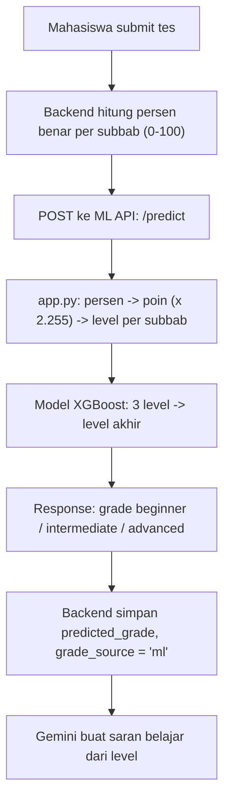

# ML Deploy Plan — Klasifikasi Level IAET (`test-capstone.ipynb`)

Tujuan: Mahasiswa submit pretest / real test, backend Express memanggil API ML FastAPI, level akhir tersimpan dengan `grade_source = 'ml'`.

---

## 1. Aturan Final & Pembagian Soal (Format Tim IAET: Rata 50 Soal / Total 150 Soal)

Format resmi tes IAET-SIM:
1. **Listening Comprehension**: **50 Soal**
2. **Structure & Written Expression (SWE)**: **50 Soal**
3. **Reading Comprehension**: **50 Soal**  
**Total: 150 Soal** (Rata 50 soal per subbab, 4,51 poin per soal benar)

- Skor maksimal per subbab: 50 × 4,51 = **225,50 poin**.
- Skor maksimal total (`overall_score`): 3 × 225,50 = **676,50 poin**.

### Threshold Level per Subbab (Sama Persis untuk Listening, Structure, & Reading)

Backend menghitung nilai dalam **persentase (0–100%)** via rumus: `(jumlah_benar / total_soal) * 100`.
Karena semua subbab rata 50 butir soal, pembagiannya seragam:

| Subbab | Total Soal | 🥉 Beginner (≤ 30%) | 🥈 Intermediate (32%–80%) | 🥇 Advanced (≥ 82%) |
|---|---|---|---|---|
| **Listening** | 50 soal | **0 – 15 soal** benar (skor 0 – 67,65) | **16 – 40 soal** benar (skor 72,16 – 180,40) | **41 – 50 soal** benar (skor 184,91 – 225,50) |
| **Structure (SWE)** | 50 soal | **0 – 15 soal** benar (skor 0 – 67,65) | **16 – 40 soal** benar (skor 72,16 – 180,40) | **41 – 50 soal** benar (skor 184,91 – 225,50) |
| **Reading** | 50 soal | **0 – 15 soal** benar (skor 0 – 67,65) | **16 – 40 soal** benar (skor 72,16 – 180,40) | **41 – 50 soal** benar (skor 184,91 – 225,50) |

> **Ambang Batas Pemisah (Titik Tengah) di API ML (`app.py`):**
> - Batas $B_1$ (Beginner ↔ Intermediate): **69,905 poin** (setara **31,0%**)
> - Batas $B_2$ (Intermediate ↔ Advanced): **182,655 poin** (setara **81,0%**)
> 
> *Catatan:* Karena backend mengirimkan nilai dalam bentuk persentase (0–100), rumus konversi di `app.py`: `poin = (persen / 100) * 225.5` langsung memetakan nilai mahasiswa ke batas $B_1$ dan $B_2$ di atas secara 100% presisi.

### Level Akhir (`overall_level`) dari Kombinasi 3 Subbab (Urutan Tidak Berpengaruh)

| Kombinasi | Level Akhir |
|---|---|
| B, B, B | Beginner |
| B, B, I | Beginner |
| B, B, A | Intermediate |
| B, I, I | Intermediate |
| B, I, A | Intermediate |
| B, A, A | Intermediate |
| I, I, I | Intermediate |
| I, I, A | Advanced |
| I, A, A | Advanced |
| A, A, A | Advanced |

Pola: Advanced hanya didapat jika **tidak ada subbab Beginner** dan **minimal satu subbab Advanced**.

> `overall_score` tidak dipakai untuk menentukan level akhir. Rentangnya saling tumpang tindih antar level; level akhir murni dari kombinasi 3 level subbab.

---

## 2. Alur Sistem



---

## 3. Struktur Folder `iaet-ml-api/` (Repo Terpisah)

```text
iaet-ml-api/
├── .dockerignore
├── .gitignore
├── Dockerfile
├── Procfile
├── README.md
├── app.py
├── ml-deploy-plan.md
├── model_iaet_xgboost.joblib
├── render.yaml
├── requirements.txt
└── test_api.py
```

### Versi Dependensi Wajib (`requirements.txt`)
Model ditrain menggunakan:
- `scikit-learn==1.6.1` (Penting: unpickling ColumnTransformer gagal jika scikit-learn >= 1.7)
- `xgboost>=2.0.0`
- `pandas>=2.0.0`
- `numpy>=1.24.0,<2.0.0`
- `fastapi>=0.100.0`
- `uvicorn[standard]>=0.20.0`
- `joblib>=1.3.0`

---

## 4. Tabel Verifikasi Kasus Uji (Test Scenarios)

| No | Listening (%) | Structure (%) | Reading (%) | Level Subbab (L, S, R) | Expected Output |
|---|---|---|---|---|---|
| 1 | 0 | 0 | 0 | B, B, B | beginner |
| 2 | 20 | 20 | 50 | B, B, I | beginner |
| 3 | 20 | 20 | 90 | B, B, A | intermediate |
| 4 | 20 | 50 | 90 | B, I, A | intermediate |
| 5 | 24 | 84 | 90 | B, A, A | intermediate |
| 6 | 50 | 50 | 50 | I, I, I | intermediate |
| 7 | 60 | 70 | 86 | I, I, A | advanced |
| 8 | 60 | 90 | 90 | I, A, A | advanced |
| 9 | 100 | 100 | 100 | A, A, A | advanced |
| 10 | 90 | 20 | 50 | A, B, I | intermediate |

---

## 5. Panduan Deploy Cloud (Render.com)

1. Buat Web Service baru di Render, hubungkan repository `iaet-ml-api`.
2. Gunakan konfigurasi:
   - **Environment**: Python
   - **Build Command**: `pip install -r requirements.txt`
   - **Start Command**: `uvicorn app:app --host 0.0.0.0 --port $PORT`
3. Setelah deployment aktif, atur environment variable di `backend/.env`:
   ```env
   ML_API_URL=https://<nama-service-kamu>.onrender.com/predict
   ```
4. Backend otomatis memvalidasi response `{ grade: "..." }` dan menyimpan `grade_source: 'ml'`.
